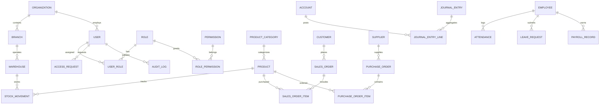

# NexaERP Database Specification & Schema

## 1. Overview
NexaERP utilizes an asynchronous SQLAlchemy 2.0 ORM architecture with declarative models. It supports SQLite (via `aiosqlite`) for frictionless local development and high-concurrency PostgreSQL (via `asyncpg`) for enterprise staging and production environments.

---

## 2. Entity Relational Model



---

## 3. Core Database Tables & Indices

- **`users`**: `id`, `email` (unique index), `hashed_password`, `full_name`, `is_active`, `is_locked`, `failed_login_attempts`, `locked_until`, `created_at`.
- **`roles`**: `id`, `name` (unique index), `description`, `is_system_role`.
- **`permissions`**: `id`, `codename` (unique index), `name`, `module`.
- **`products`**: `id`, `sku` (unique index), `barcode` (index), `name`, `category_id`, `unit_price`, `cost_price`, `current_stock`, `reorder_level`.
- **`sales_orders`**: `id`, `invoice_number` (unique index), `customer_id`, `total_amount`, `tax_amount`, `status`, `payment_method`, `created_at`.
- **`stock_movements`**: `id`, `product_id` (index), `movement_type` (`SALE`, `PURCHASE_RECEIPT`, `ADJUSTMENT`, `RETURN`), `quantity`, `reference_id`, `created_at`.
- **`access_requests`**: `id`, `user_id` (index), `requested_role_id`, `reason`, `duration_minutes`, `status` (`PENDING`, `APPROVED`, `REJECTED`, `EXPIRED`, `REVOKED`), `approved_by_id`, `expires_at`.
- **`audit_logs`**: `id`, `user_id` (index), `action`, `resource_type`, `ip_address`, `details_json`, `created_at`.

---

## 4. Backup & Restore Procedures

### SQLite (Development)
```bash
# Hot snapshot backup using sqlite3 CLI
sqlite3 nexaerp.db ".backup 'backups/nexaerp_backup_$(date +%Y%m%d%H%M%S).db'"
```

### PostgreSQL (Production)
```bash
# Automated dump
pg_dump -U nexaerp -h localhost -d nexaerp_prod -F c -b -v -f /backups/nexaerp_$(date +%Y%m%d_%H%M%S).dump

# Point-in-time restore
pg_restore -U nexaerp -h localhost -d nexaerp_prod -v /backups/nexaerp_20261015.dump
```
