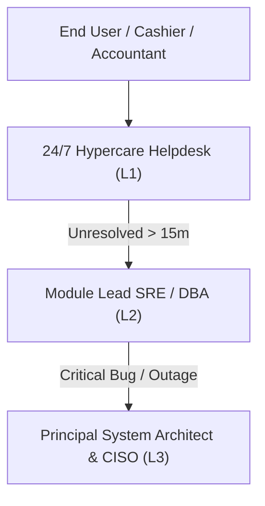

# NexaERP 24/7 Hypercare Support Runbook (Task 50.2)
Requirement: 20.6

---

## 1. Hypercare Support Protocol (Weeks 1 & 2)

### 1.1 Objectives
- Provide uninterrupted 24/7 real-time monitoring and incident resolution during initial production cutover.
- Ensure 99.9% system availability and maintain sub-200ms p95 page response time.
- Rapid escalation and hotfix deployment for any critical-path operational blocks.

---

## 2. Incident Severity & SLA Response Times

| Severity Level | Definition | First Response SLA | Resolution Target |
|---|---|---|---|
| **P1 - Critical** | Catastrophic outage, database unreachable, POS terminal checkout blocked across branches. | &le; 15 minutes | &le; 2 hours |
| **P2 - High** | Key module degradation (e.g., payroll batch delay, inventory transfer sync lag). Workaround available. | &le; 30 minutes | &le; 4 hours |
| **P3 - Medium** | Non-blocking functional defect, reporting layout formatting issue. | &le; 2 hours | &le; 24 hours |
| **P4 - Low** | Minor cosmetic defect, user configuration query, enhancement suggestion. | &le; 4 hours | Next maintenance release |

---

## 3. Incident Command Escalation Tree

---

## 4. Key Daily Health Checkpoints
1. **06:00 UTC**: Daily backup verification (`GET /api/disaster-recovery/status`). Confirm 90+ day retention compliance.
2. **08:00 UTC**: Store opening readiness check across all retail branches and POS registers.
3. **14:00 UTC**: Peak load telemetry review. Confirm p95 latency remains < 100ms.
4. **22:00 UTC**: Daily sales reconciliation and automated General Ledger balancing.
