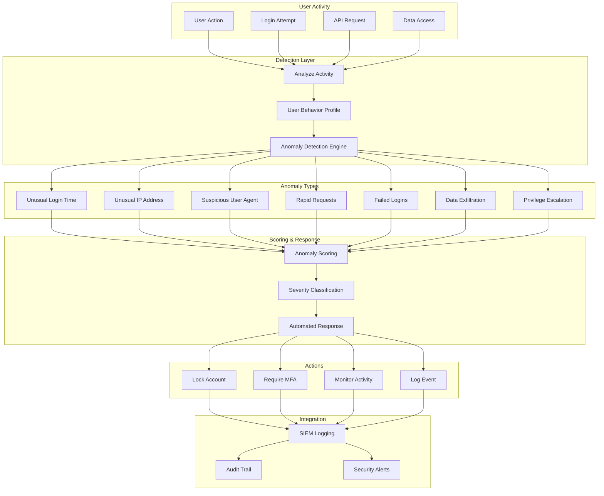
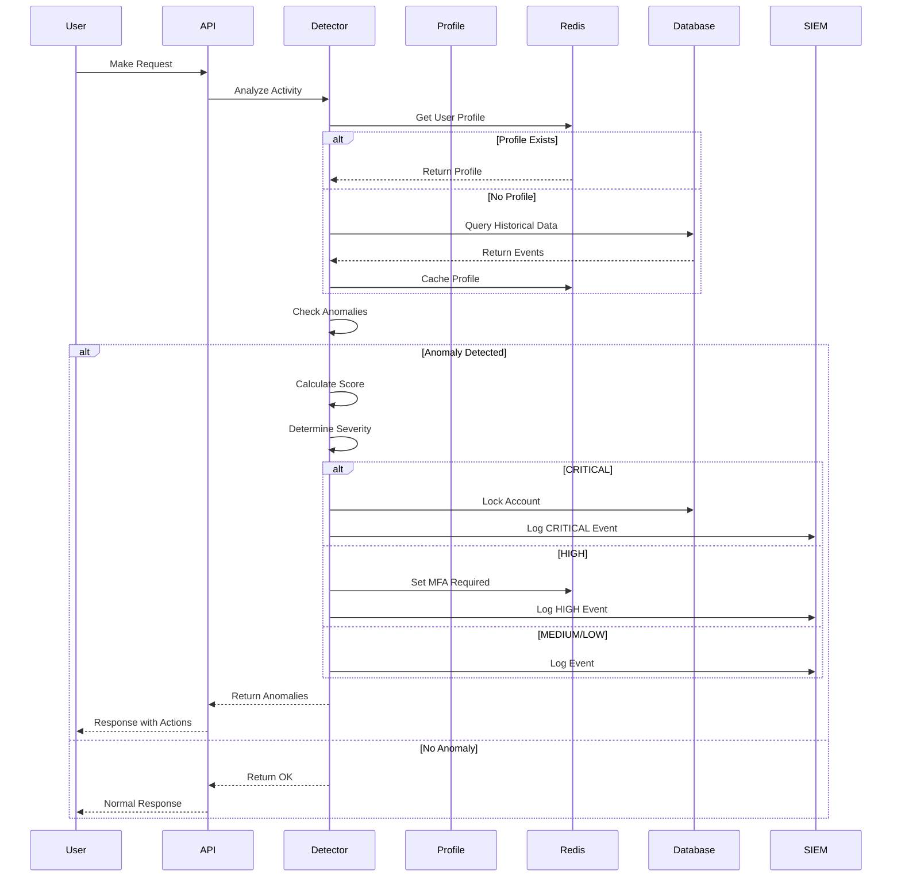
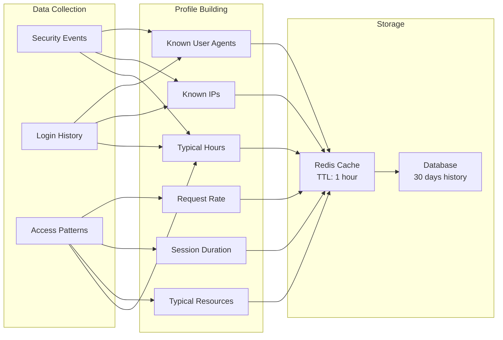
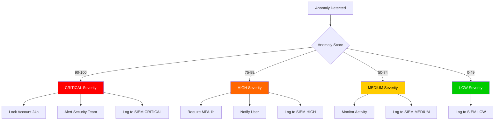
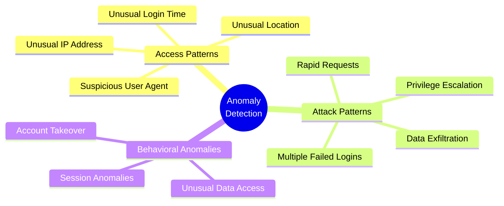
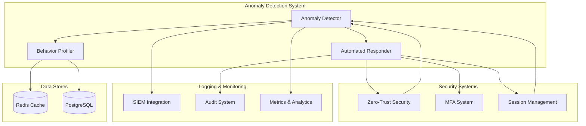
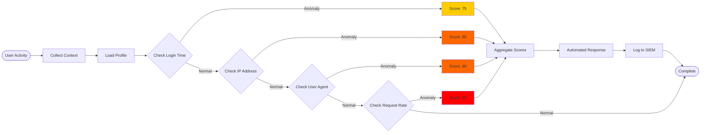
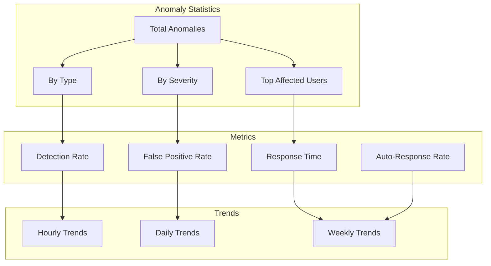

# Anomaly Detection System Architecture

## System Overview

## Detection Flow

## User Behavior Profiling

## Severity-Based Response Matrix

## Anomaly Detection Types

## Integration Architecture

## Real-Time Detection Pipeline

## Statistics Dashboard

## Key Components

### 1. Anomaly Detection Service
- Core detection engine
- User behavior profiling
- Anomaly scoring
- Automated response

### 2. Detection Types
- 10 different anomaly types
- Configurable thresholds
- Real-time detection
- Historical analysis

### 3. Response System
- Severity-based actions
- Account locking
- MFA requirements
- Activity monitoring

### 4. Integration Points
- SIEM logging
- Audit trail
- Zero-trust security
- Session management

### 5. Monitoring
- Real-time statistics
- Trend analysis
- Performance metrics
- Alert management

## Performance Characteristics

- **Detection Latency**: < 100ms
- **Profile Cache Hit Rate**: > 90%
- **False Positive Rate**: < 5%
- **Automated Response Time**: < 1 second
- **SIEM Logging Latency**: < 500ms

## Scalability

- **Horizontal Scaling**: Stateless detection engine
- **Redis Caching**: Distributed profile storage
- **Async Processing**: Non-blocking operations
- **Batch Operations**: Efficient database queries
- **Load Balancing**: Multiple detector instances
